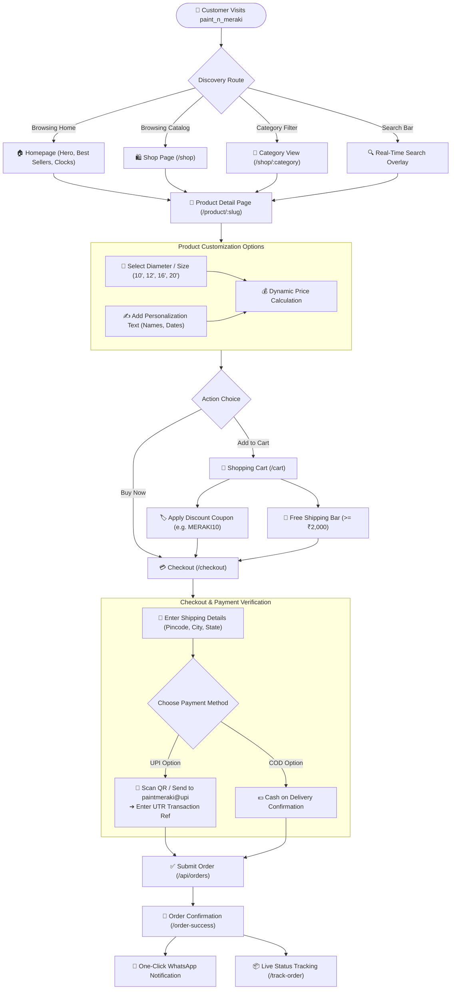
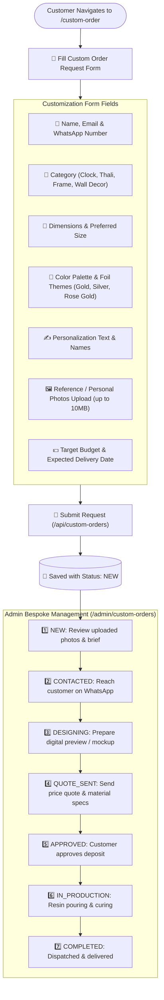
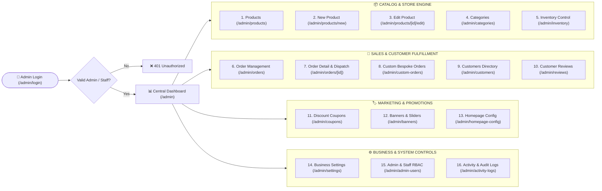
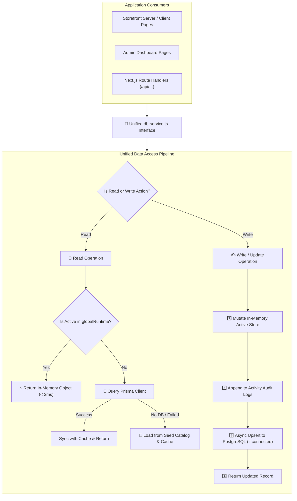

# 🌐 paint_n_meraki — Comprehensive Website Overview, Sitemap & Visual Architecture Guide

> **Brand**: paint_n_meraki  
> **Founder & Lead Artist**: Astha Patel  
> **Platform Type**: Luxury E-Commerce & Custom Resin Art Management System  
> **Tech Stack**: Next.js 16 (App Router), React 19, TypeScript 5, Tailwind CSS v4, Prisma 7, PostgreSQL, Zustand 5, BcryptJS  
> **Companion Graph Guide**: [**`WEBSITE_STRUCTURE_GRAPH.md`**](./WEBSITE_STRUCTURE_GRAPH.md)  

---

## 📑 Table of Contents

1. [System Architecture Graph (High-Level Overview)](#-system-architecture-graph-high-level-overview)
2. [Customer Journey & Shopping Flow Graph](#-customer-journey--shopping-flow-graph)
3. [Custom Bespoke Order Lifecycle Graph](#-custom-bespoke-order-lifecycle-graph)
4. [Admin Management Panel Flow Graph (16 Modules)](#-admin-management-panel-flow-graph-16-modules)
5. [Authentication & Role-Based Access Control (RBAC) Graph](#-authentication--role-based-access-control-rbac-graph)
6. [Unified Data Service & Dual-Layer Persistence Graph](#-unified-data-service--dual-layer-persistence-graph)
7. [Complete Hierarchical Sitemap](#-complete-hierarchical-sitemap)
   - [Public Customer Storefront Sitemap](#1-public-customer-storefront-sitemap)
   - [Admin Panel Management Sitemap](#2-admin-panel-management-sitemap)
   - [REST API Route Map](#3-rest-api-route-map)
8. [Storefront & Admin Visual Layout Wireframes](#-storefront--admin-visual-layout-wireframes)
   - [Customer Storefront UI Architecture](#customer-storefront-ui-architecture)
   - [Admin Control Center UI Architecture](#admin-control-center-ui-architecture)
9. [Detailed Module-by-Module Reference](#-detailed-module-by-module-reference)

---

## 🏗️ System Architecture Graph (High-Level Overview)

The following Mermaid graph visualizes the entire system architecture connecting the public storefront, the luxury admin console, the unified Next.js API layer, and the resilient data persistence layer:

```mermaid
flowchart TB
    subgraph CLIENT_LAYER["🖥️ CLIENT LAYER (Browser)"]
        direction TB
        subgraph STOREFRONT_UI["Public Storefront (/...)"]
            SF_HOME["🏠 Homepage (/)"]
            SF_SHOP["🛍️ Shop & Categories (/shop)"]
            SF_PDP["🎨 Product Detail (/product/:slug)"]
            SF_CUSTOM["✨ Custom Order (/custom-order)"]
            SF_CART["🛒 Cart & Checkout (/cart, /checkout)"]
            SF_TRACK["📦 Order Success & Tracking (/track-order)"]
            SF_USER["👤 Customer Account (/account, /wishlist)"]
        end

        subgraph ADMIN_UI["Admin Console (/admin/...)"]
            AD_LOGIN["🔐 Secure Login (/admin/login)"]
            AD_DASH["📊 Dashboard & KPI Metrics (/admin)"]
            AD_CATALOG["📦 Products & Categories (/admin/products, /categories)"]
            AD_ORDERS["📑 Orders & Custom Requests (/admin/orders, /custom-orders)"]
            AD_MARKETING["🏷️ Coupons & Banners (/admin/coupons, /banners)"]
            AD_REVIEWS["⭐ Reviews & Customers (/admin/reviews, /customers)"]
            AD_SYSTEM["⚙️ Settings, Homepage, Users, Logs (/admin/settings, /logs)"]
        end
    end

    subgraph STATE_LAYER["⚡ CLIENT STATE LAYER (Zustand Stores)"]
        ST_CART["🛒 useCartStore (Local Persistence)"]
        ST_WISH["❤️ useWishlistStore"]
        ST_AUTH["👤 useAuthStore"]
        ST_ORDER["📦 useOrderStore"]
    end

    subgraph API_LAYER["⚙️ NEXT.JS 16 SERVER & API LAYER"]
        direction TB
        subgraph PUBLIC_API["Public API Routes (/api/...)"]
            API_PROD["/api/products"]
            API_CAT["/api/categories"]
            API_ORD["/api/orders"]
            API_CUST_ORD["/api/custom-orders"]
            API_REV["/api/reviews"]
            API_COUP["/api/coupons"]
            API_SET["/api/settings"]
        end

        subgraph ADMIN_API["Admin Secure API Routes (/api/admin/...)"]
            AUTH_MID["🛡️ Admin Session Auth Middleware"]
            API_AD_AUTH["/api/admin/auth/* (login, me, logout)"]
            API_AD_PROD["/api/admin/products"]
            API_AD_CAT["/api/admin/categories"]
            API_AD_ORD["/api/admin/orders"]
            API_AD_CUST["/api/admin/custom-orders"]
            API_AD_REV["/api/admin/reviews"]
            API_AD_COUP["/api/admin/coupons"]
            API_AD_BAN["/api/admin/banners"]
            API_AD_USERS["/api/admin/users"]
            API_AD_SET["/api/admin/settings"]
            API_AD_ANALYTICS["/api/admin/analytics"]
            API_AD_ACTIVITY["/api/admin/activity-logs"]
        end
    end

    subgraph SERVICE_LAYER["🧠 UNIFIED RESILIENT DATA SERVICE (db-service.ts)"]
        DB_ROUTER{"Active Runtime Router"}
        MEM_STORE[("⚡ In-Memory Active Runtime Store\n(Instant Zero-Lag Mutation)")]
        PRISMA_CLIENT["🛡️ Prisma ORM 7.9 Client"]
    end

    subgraph PERSISTENCE_LAYER["💾 PERSISTENCE & DATABASE"]
        PG_DB[("🐘 PostgreSQL Database\n(Prisma Models & Relations)")]
        SEED_DATA["🌱 Seed Products & Categories Engine"]
    end

    %% Client State Connections
    SF_CART --> ST_CART
    SF_PDP --> ST_CART
    SF_PDP --> ST_WISH
    SF_USER --> ST_AUTH

    %% Client to API Connections
    SF_SHOP --> API_PROD & API_CAT
    SF_PDP --> API_PROD
    SF_CUSTOM --> API_CUST_ORD
    SF_CART --> API_COUP
    SF_TRACK --> API_ORD

    AD_LOGIN --> API_AD_AUTH
    AD_DASH --> API_AD_ANALYTICS
    AD_CATALOG --> API_AD_PROD & API_AD_CAT
    AD_ORDERS --> API_AD_ORD & API_AD_CUST
    AD_MARKETING --> API_AD_COUP & API_AD_BAN
    AD_REVIEWS --> API_AD_REV & API_AD_USERS
    AD_SYSTEM --> API_AD_SET & API_AD_ACTIVITY

    %% API to Middleware & Service
    ADMIN_API --> AUTH_MID
    AUTH_MID --> DB_ROUTER
    PUBLIC_API --> DB_ROUTER

    %% Service to Persistence
    DB_ROUTER --> MEM_STORE
    DB_ROUTER --> PRISMA_CLIENT
    PRISMA_CLIENT -.-> PG_DB
    DB_ROUTER -.-> SEED_DATA
```



---

## 🛒 Customer Journey & Shopping Flow Graph



---

## ✨ Custom Bespoke Order Lifecycle Graph



---

## 🎛️ Admin Management Panel Flow Graph (16 Modules)



---

## 🔐 Authentication & Role-Based Access Control (RBAC) Graph

```mermaid
flowchart TD
    REQ["🌐 User Requests /admin or /api/admin/*"] --> COOKIE{"Check paint_meraki_admin_session Cookie"}

    COOKIE -->|No Cookie| TO_LOGIN["🔀 Redirect to /admin/login"]
    COOKIE -->|Has Cookie| VERIFY{"Verify & Decode Base64 Token"}

    VERIFY -->|Expired or Tampered| TO_LOGIN
    VERIFY -->|Valid Session| ROLE_CHECK{"Evaluate Role"}

    ROLE_CHECK -->|Role: ADMIN (Superadmin)| FULL_ACCESS["👑 Full Access: All 16 Modules\n+ Settings, Admin Users & Audit Logs"]
    ROLE_CHECK -->|Role: STAFF (Team Member)| STAFF_ACCESS["👥 Staff Access: Products, Categories,\nOrders, Custom Requests, Inventory, Reviews"]

    STAFF_ACCESS --> BLOCKED_CHECK{"Attempts accessing /admin/admin-users or /admin/settings?"}
    BLOCKED_CHECK -->|Yes| FORBIDDEN["🚫 403 Forbidden Toast & Screen"]
    BLOCKED_CHECK -->|No| ALLOW["✅ Render Allowed View"]
```

---

## 🧠 Unified Data Service & Dual-Layer Persistence Graph



---

## 🗺️ Complete Hierarchical Sitemap

### 1. Public Customer Storefront Sitemap

```
/ (Root)
│
├── 🏠 / ............................................. Main Luxury Homepage (Hero, Featured, Best Sellers, Trust Badges)
│
├── 🛍️ /shop ......................................... Complete Product Catalog with Multi-Facet Filters
│   ├── /shop/resin-clocks ............................ Category: Handcrafted Geode & Marble Resin Clocks
│   ├── /shop/pooja-thalis ............................ Category: Auspicious Resin Pooja Thalis & Shubh Labh
│   ├── /shop/decorative-frames ....................... Category: Bespoke Preservation & Photo Frames
│   ├── /shop/resin-hanging-decor ..................... Category: Wall Hangings, Car Hangings & Nameplates
│   └── /shop/resin-coasters .......................... Category: Luxury Geode Agate Resin Coasters
│
├── 🎨 /product/[slug] ................................ Dynamic Product Detail Page
│   ├── Multi-angle Image Gallery with Zoom Preview
│   ├── Diameter / Size Selector (10", 12", 16", 20")
│   ├── Custom Personalization Name & Date Input
│   ├── Material Specifications, Dimensions & Care Guide
│   └── Reviews Breakdown & Star Rating Showcase
│
├── ✨ /custom-order ................................. Bespoke Custom Order Request Engine
│   ├── Reference Image & Personal Photo Uploader
│   ├── Preferred Dimensions, Palette & Gold/Silver Leaf Theme
│   └── WhatsApp Direct Consultation Request
│
├── 🛒 /cart ......................................... Interactive Shopping Cart
│   ├── Quantity Modifiers & Instant Price Recalculation
│   ├── Dynamic Free Shipping Progress Bar (₹2,000 threshold)
│   ├── Coupon Code Validator (MERAKI10, FESTIVE250)
│   └── Order Subtotal, Shipping & Estimated Taxes
│
├── 💳 /checkout ..................................... Two-Step Checkout & Payment Terminal
│   ├── Shipping Address Form with Indian Pincode / State Support
│   ├── Payment Mode: UPI QR Code / UPI ID (paintmeraki@upi) + UTR Input
│   └── Payment Mode: Cash on Delivery (COD)
│
├── 🎉 /order-success ................................ Order Placement Confirmation Screen
│   ├── Order Summary Card & Items Breakdown
│   ├── UTR & Payment Status Display
│   └── One-Click WhatsApp Order Status Broadcast
│
├── 📦 /track-order .................................. Real-Time Order Lookup
│   └── Search by Order Number (e.g. PM1001) + Mobile Number
│
├── ⭐ /reviews ....................................... Customer Testimonials & Verified Ratings Showcase
│
├── 📖 /about ......................................... Brand Story, Philosophy & Artist Astha Patel Bio
│
├── 📞 /contact ....................................... Contact Information, Studio Location & Inquiry Form
│
├── ❤️ /wishlist ...................................... Saved Wishlist Items (Zustand Local Storage)
│
└── 👤 /account ....................................... Customer Authentication & Account Dashboard
    ├── /account/login ............................... Customer Login
    ├── /account/signup .............................. New Customer Registration
    ├── /account/orders .............................. Customer Order History
    └── /account/orders/[orderNumber] ................ Detailed Customer Order Invoice View
```

---

### 2. Admin Panel Management Sitemap

```
/admin (Admin Console Root)
│
├── 🔐 /admin/login .................................. Luxury Styled Secure Admin Login (Bcrypt Authentication)
│
├── 📊 /admin ........................................ Master Admin KPI Dashboard
│   ├── Revenue, Order Count, Custom Requests & Customer Stats
│   ├── Quick Status Breakdown & Recent 5 Orders Table
│   └── Direct Action Shortcuts
│
├── 📦 /admin/products ............................... Product Catalog Management
│   ├── Search, Category Filter & Stock Status Filter
│   ├── Quick Price & Stock Adjustments
│   ├── Active / Inactive Visibility Toggle
│   ├── ➕ /admin/products/new ....................... Rich New Product Creation Form
│   └── ✏️ /admin/products/[id]/edit ................. Product Editor (Images, Multi-Sizes, Specs)
│
├── 📂 /admin/categories ............................. Category Hierarchy & Banner Manager
│   └── Category Name, Slug, Description, Banner Image & Live Count
│
├── 📑 /admin/orders ................................. Full Order Management & Processing
│   ├── Status Filter: PENDING, PAYMENT_VERIFICATION, CONFIRMED, PROCESSING, SHIPPED, DELIVERED
│   ├── Payment Mode Filter: UPI vs COD
│   ├── Search by Order #, Customer Name, Mobile, Email
│   └── 🔍 /admin/orders/[id] ........................ Full Order Inspector & Courier Dispatcher
│       ├── Item Details, Selected Dimensions & Custom Inscription
│       ├── Shipping Address & Pincode
│       ├── Payment Status Switcher (PENDING, CONFIRMED, FAILED)
│       └── Courier Assignment (Courier Name + Tracking Number)
│
├── ✨ /admin/custom-orders .......................... Bespoke Custom Order Inquiries
│   ├── Reference Photo Previews & High-Res Inspection
│   ├── Lifecycle Status Switcher (NEW ➔ CONTACTED ➔ DESIGNING ➔ QUOTE_SENT ➔ APPROVED ➔ IN_PROD ➔ COMPLETED)
│   └── One-Click WhatsApp Direct Chat with Pre-Filled Inscription
│
├── 🏷️ /admin/coupons ................................ Promo & Discount Coupon Engine
│   ├── Code Creator (Percentage % vs Flat ₹ Discount)
│   ├── Minimum Order Amount & Maximum Discount Cap
│   └── Expiry Date, Usage Limits & Active Toggle
│
├── ⭐ /admin/reviews ................................ Customer Reviews Moderation
│   ├── Star Rating, Product Attachment & Reviewer Details
│   ├── Status Toggle: APPROVED (visible on storefront) vs PENDING / REJECTED
│   └── Delete & Moderation Tools
│
├── 🖼️ /admin/banners ................................ Promotional Banners & Hero Sliders
│   ├── Banner Title, Subtitle, CTA Button Text & Destination URL
│   ├── Desktop & Mobile Optimized Image URLs
│   └── Sort Order & Live Toggle
│
├── 👥 /admin/customers .............................. Customer Directory & CRM
│   ├── Total Orders Placed & Lifetime Value (LTV) Calculation
│   └── Direct WhatsApp & Phone Contact Links
│
├── 📊 /admin/inventory .............................. Stock Control & Low-Stock Alerts
│   ├── Stock Level Monitor with Threshold Badges
│   └── Quick Inline Stock Increment / Decrement
│
├── 🏠 /admin/homepage-config ........................ Dynamic Homepage CMS
│   ├── Hero Headline, Subtitle, Description & Main Hero Image
│   └── Selectable Featured Categories, Best Sellers & New Arrivals
│
├── ⚙️ /admin/settings ............................... Store Business Settings (Superadmin Only)
│   ├── Business Name, Email, Support WhatsApp
│   ├── Merchant UPI ID & Payment QR Code
│   ├── COD Enable/Disable & Maximum COD Order Value
│   ├── Shipping Charge & Free Shipping Threshold
│   └── Dynamic Announcement Banner Bar Text
│
├── 🛡️ /admin/admin-users ............................ Team Member & Role Management (Superadmin Only)
│   ├── Add New Staff Member (Role: ADMIN vs STAFF)
│   └── Delete / Deactivate Team Member Accounts
│
└── 📜 /admin/activity-logs .......................... System Audit & Activity Log (Superadmin Only)
    └── Chronological record of Logins, Orders, Price Updates, Product Edits & Deletions
```

---

### 3. REST API Route Map

| Method | Route Path | Description | Access Level |
| :--- | :--- | :--- | :--- |
| `GET` | `/api/products` | Get public catalog with category & price filtering | Public |
| `GET` | `/api/categories` | Get public active categories | Public |
| `POST` | `/api/orders` | Place a new customer order (UPI / COD) | Public |
| `GET` | `/api/orders?orderNumber=...` | Look up order tracking details | Public |
| `POST` | `/api/custom-orders` | Submit bespoke custom order request with photos | Public |
| `GET` | `/api/reviews` | Get verified customer reviews for storefront | Public |
| `POST` | `/api/coupons/validate` | Validate coupon code against cart subtotal | Public |
| `GET` | `/api/settings` | Get public business settings & announcement bar | Public |
| `POST` | `/api/admin/auth/login` | Secure admin credentials login (Bcrypt) | Public |
| `GET` | `/api/admin/auth/me` | Fetch authenticated admin session | Admin / Staff |
| `POST` | `/api/admin/auth/logout` | Terminate session & clear cookies | Admin / Staff |
| `GET`, `POST`, `PUT`, `DELETE` | `/api/admin/products` | Full CRUD for product catalog | Admin / Staff |
| `GET`, `POST`, `PUT`, `DELETE` | `/api/admin/categories` | Manage store categories | Admin / Staff |
| `GET`, `PUT`, `DELETE` | `/api/admin/orders` | Manage orders, payment & courier dispatch | Admin / Staff |
| `GET`, `PUT`, `DELETE` | `/api/admin/custom-orders` | Manage bespoke requests & stage workflow | Admin / Staff |
| `GET`, `POST`, `PUT`, `DELETE` | `/api/admin/coupons` | Manage discount coupons & limits | Admin / Staff |
| `GET`, `PUT`, `DELETE` | `/api/admin/reviews` | Moderate customer reviews | Admin / Staff |
| `GET`, `POST`, `PUT`, `DELETE` | `/api/admin/banners` | Manage promotional banners | Admin / Staff |
| `GET`, `PUT` | `/api/admin/homepage-config` | Update homepage layout & featured items | Admin / Staff |
| `GET` | `/api/admin/analytics` | Master metrics & revenue chart data | Admin / Staff |
| `GET`, `PUT` | `/api/admin/settings` | Update store configuration & UPI settings | Superadmin Only |
| `GET`, `POST`, `DELETE` | `/api/admin/users` | Add, list, or remove staff members | Superadmin Only |
| `GET` | `/api/admin/activity-logs` | Retrieve chronological audit trail | Superadmin Only |

---

## 🎨 Storefront & Admin Visual Layout Wireframes

### Customer Storefront UI Architecture

```
+-----------------------------------------------------------------------------------+
|  ANNOUNCEMENT BAR: ♡ Handmade with Love | Free Shipping Above ₹2,000 ♡            |
+-----------------------------------------------------------------------------------+
|  [LOGO] paint_n_meraki      Home   Shop   Custom Art   Reviews   About   Contact  |
|                             [🔍 Search]  [❤️ Wishlist]  [🛒 Cart (3)]  [👤 Account] |
+-----------------------------------------------------------------------------------+
|                                                                                   |
|  [ HERO SECTION ]                                                                 |
|  "Art That Speaks to Your Soul"                                                   |
|  Handcrafted Resin Masterpieces & Custom Decor                                    |
|  [ Explore Collection -> ]   [ Order Custom Piece ]        [ HERO IMAGE CAROUSEL] |
|                                                                                   |
+-----------------------------------------------------------------------------------+
|  FEATURED CATEGORIES                                                              |
|  [ Resin Clocks ]    [ Pooja Thalis ]    [ Preservation Frames ]   [ Nameplates ] |
+-----------------------------------------------------------------------------------+
|  BEST SELLER RESIN CREATIONS                                                      |
|  +-------------------+  +-------------------+  +-------------------+              |
|  | [Product Image]   |  | [Product Image]   |  | [Product Image]   |              |
|  | Geode Resin Clock |  | Royal Pooja Thali |  | Resin Wall Decor  |              |
|  | ₹2,499  ★★★★★ (18)|  | ₹1,599  ★★★★★ (12)|  | ₹3,299  ★★★★★ (9) |              |
|  | [ Add to Cart ]   |  | [ Add to Cart ]   |  | [ Add to Cart ]   |              |
|  +-------------------+  +-------------------+  +-------------------+              |
+-----------------------------------------------------------------------------------+
|  WHY CHOOSE PAINT_N_MERAKI                                                        |
|  [ 💎 100% Handcrafted ]  [ 🚚 Pan-India Shipping ]  [ 🛡️ Non-Yellowing Resin ]   |
+-----------------------------------------------------------------------------------+
|  FOOTER: Brand Bio | Quick Links | Policies | Contact | WhatsApp Chat Float       |
+-----------------------------------------------------------------------------------+
```

---

### Admin Control Center UI Architecture

```
+-----------------------------------------------------------------------------------+
|  [M] paint_n_meraki ADMIN       [🔍 Quick Search...]   [🔔 Alerts]  [👑 Astha (Admin)]|
+-------------------+---------------------------------------------------------------+
|  NAVIGATION       |  DASHBOARD OVERVIEW                                           |
|                   |  +---------------+ +---------------+ +---------------+        |
|  📊 Dashboard     |  | Total Revenue | | Total Orders  | | Custom Orders |        |
|  📦 Products (16) |  | ₹1,42,850     | | 48 Orders     | | 12 Requests   |        |
|  📂 Categories (5)|  +---------------+ +---------------+ +---------------+        |
|  📑 Orders (48)   |                                                               |
|  ✨ Custom Orders |  RECENT STORE ORDERS (Live Status Tracking)                   |
|  🏷️ Coupons       |  Order #   Customer        Items      Total     Payment Status|
|  ⭐ Reviews       |  PM1001    Radhika Sharma  1 Clock    ₹2,499    UPI     CONFIRMED
|  🖼️ Banners       |  PM1002    Pooja Varma     1 Thali    ₹1,698    COD     PENDING  |
|  👥 Customers     |  PM1003    Karan Mehta     2 Coasters ₹1,198    UPI     CONFIRMED
|  📊 Inventory     |                                                               |
|  🏠 Homepage CMS  |  QUICK ACTIONS:                                               |
|  ⚙️ Settings       |  [➕ New Product]  [📑 Manage Orders]  [✨ View Bespoke Custom]|
|  🛡️ Admin Users   |                                                               |
|  📜 Activity Logs |                                                               |
|  🚪 Sign Out      |                                                               |
+-------------------+---------------------------------------------------------------+
```

---

## 🔍 Detailed Module-by-Module Reference

### 1. Products & Catalog Engine (`/admin/products`)
- Lists all products with thumbnail, SKU, category tag, pricing, stock count, and active status.
- Supports bulk search and category filtering.
- **Product Creator & Editor** supports:
  - Title, URL slug, description, short summary.
  - Image gallery management with primary preview selection.
  - Multiple selectable size variants with custom prices (e.g. 10", 12", 16", 20").
  - Rich specs: Resin grade, wood base, pigment type, dimensions, dispatch time.
  - Boolean flags: `isFeatured`, `isBestSeller`, `isNewArrival`, `inStock`.

### 2. Order Processing & Dispatch Engine (`/admin/orders`)
- Central order dashboard tracking both UPI payments and Cash on Delivery.
- Order details drawer/page displays:
  - Customer contact details with direct WhatsApp button.
  - Indian shipping address format with landmark and pincode.
  - Items list with selected dimensions and custom inscriptions.
  - Status progression buttons: `PENDING` ➔ `CONFIRMED` ➔ `PROCESSING` ➔ `SHIPPED` ➔ `DELIVERED`.
  - Courier assignment with tracking ID generation.

### 3. Bespoke Custom Orders Hub (`/admin/custom-orders`)
- Specially tailored for resin art commissions (flower preservation, anniversary nameplates, customized wall clocks).
- Direct high-resolution preview of reference images uploaded by customers.
- 7-stage commission tracking pipeline.

### 4. Promotion & Coupons Manager (`/admin/coupons`)
- Create discount campaigns with percentage or fixed amount discounts.
- Enforce minimum spend thresholds and maximum discount caps.
- Set coupon start/end dates and overall usage limits.

### 5. Store Settings & Business Configuration (`/admin/settings`)
- Configure store branding, logo, and announcement bar.
- Update UPI payment receiver details (`paintmeraki@upi`) and upload payment QR codes.
- Toggle Cash on Delivery (COD) availability and threshold rules.
- Set shipping rates and free shipping milestones.

### 6. Team & Staff Role-Based Access Control (`/admin/admin-users`)
- Superadmin access control to create team members with specific roles (`ADMIN` vs `STAFF`).
- Secure bcrypt password hashing.

---

*Document compiled for **paint_n_meraki** — Handcrafted Resin Art & Home Decor Platform.*
