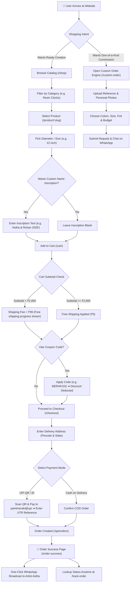
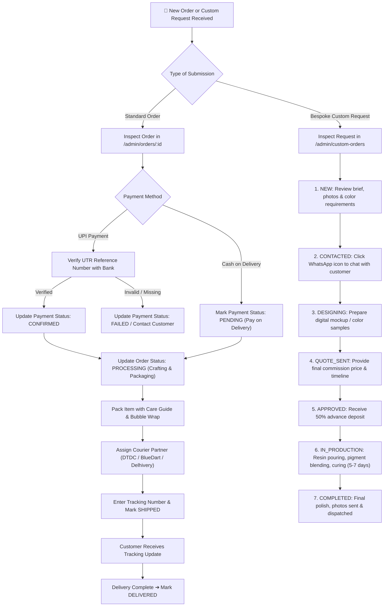
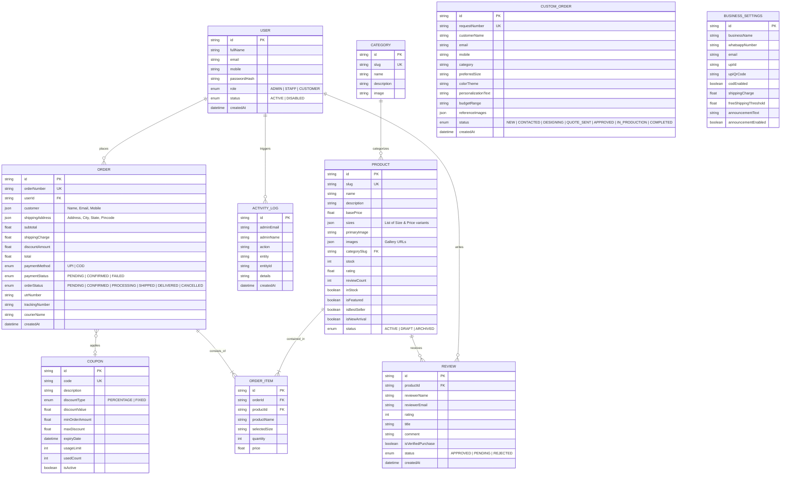
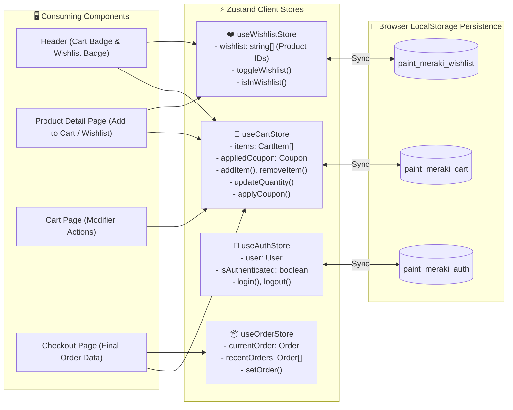

# 🗺️ paint_n_meraki — Complete Website Structure (Graph & Visual Flow View)

> **Visual Reference Document**: Comprehensive structural graph view of the entire **paint_n_meraki** ecosystem — covering the customer shopping storefront, the 16-module admin panel, data relationships, and component hierarchies.

---

## 📑 Table of Contents

1. [Master End-to-End Website Structure Graph](#1-master-end-to-end-website-structure-graph)
2. [Customer Storefront Structure & Component Hierarchy](#2-customer-storefront-structure--component-hierarchy)
3. [Admin Panel Control Center Structure Graph](#3-admin-panel-control-center-structure-graph)
4. [Customer E-Commerce Interactive Decision Graph](#4-customer-e-commerce-interactive-decision-graph)
5. [Admin Operations & Dispatch Workflow Graph](#5-admin-operations--dispatch-workflow-graph)
6. [Data Entity Relationship (ER) Graph](#6-data-entity-relationship-er-graph)
7. [Client State (Zustand) & Storage Flow Graph](#7-client-state-zustand--storage-flow-graph)
8. [Comprehensive URL Route & Component Mapping Matrix](#8-comprehensive-url-route--component-mapping-matrix)

---

## 1. Master End-to-End Website Structure Graph

The following diagram illustrates the complete top-level structure of `paint_n_meraki`, splitting into the **Customer Storefront** and the **Admin Management Panel**:

```mermaid
graph TD
    %% Global Root
    ROOT(["🌐 paint_n_meraki (Root Domain)"])

    %% Primary Branches
    ROOT --> STOREFRONT["🛍️ CUSTOMER STOREFRONT\n(Public Access)"]
    ROOT --> ADMIN["🔐 ADMIN MANAGEMENT PANEL\n(Role-Protected /admin)"]
    ROOT --> API_BACKEND["⚙️ NEXT.JS 16 API BACKEND\n(Unified REST Layer)"]

    %% Storefront Main Sections
    subgraph SF_SECTION["🛍️ Storefront Structure"]
        STOREFRONT --> SF_HOME["🏠 Homepage (/)"]
        STOREFRONT --> SF_SHOP["🎨 Shop & Catalog (/shop)"]
        STOREFRONT --> SF_CUSTOM["✨ Custom Bespoke Art (/custom-order)"]
        STOREFRONT --> SF_REVIEWS["⭐ Customer Reviews (/reviews)"]
        STOREFRONT --> SF_ABOUT["📖 Brand & Artist Bio (/about)"]
        STOREFRONT --> SF_CONTACT["📞 Contact & Studio (/contact)"]
        STOREFRONT --> SF_CART["🛒 Shopping Cart (/cart)"]
        STOREFRONT --> SF_CHECKOUT["💳 Checkout Terminal (/checkout)"]
        STOREFRONT --> SF_TRACK["📦 Order Lookup (/track-order)"]
        STOREFRONT --> SF_ACCOUNT["👤 Customer Portal (/account)"]
        STOREFRONT --> SF_WISH["❤️ Saved Wishlist (/wishlist)"]
    end

    %% Admin Main Sections
    subgraph AD_SECTION["🔐 Admin Panel Structure"]
        ADMIN --> AD_LOGIN["🔑 Secure Login (/admin/login)"]
        AD_LOGIN --> AD_DASH["📊 KPI Master Dashboard (/admin)"]
        
        AD_DASH --> AD_CATALOG["📦 Catalog & Products\n(/admin/products, /categories, /inventory)"]
        AD_DASH --> AD_SALES["📑 Orders & Customers\n(/admin/orders, /custom-orders, /customers)"]
        AD_DASH --> AD_MKT["🏷️ Marketing & Content\n(/admin/coupons, /banners, /homepage-config, /reviews)"]
        AD_DASH --> AD_SYS["⚙️ Settings & Governance\n(/admin/settings, /admin-users, /activity-logs)"]
    end

    %% API Backend Connections
    STOREFRONT -.->|Fetch Data & Place Orders| API_BACKEND
    ADMIN -.->|Full Management & CRUD| API_BACKEND

    %% Styling
    classDef rootStyle fill:#D4AF37,stroke:#8C6D1F,stroke-width:3px,color:#fff,font-weight:bold;
    classDef sfStyle fill:#1F1C18,stroke:#D4AF37,stroke-width:2px,color:#E8E2D9;
    classDef adStyle fill:#2A241E,stroke:#B89628,stroke-width:2px,color:#FAF6F0;
    classDef apiStyle fill:#3D3730,stroke:#A69E90,stroke-width:1px,color:#D5CFC5;

    class ROOT rootStyle;
    class STOREFRONT,SF_HOME,SF_SHOP,SF_CUSTOM,SF_REVIEWS,SF_ABOUT,SF_CONTACT,SF_CART,SF_CHECKOUT,SF_TRACK,SF_ACCOUNT,SF_WISH sfStyle;
    class ADMIN,AD_LOGIN,AD_DASH,AD_CATALOG,AD_SALES,AD_MKT,AD_SYS adStyle;
    class API_BACKEND apiStyle;
```

---

## 2. Customer Storefront Structure & Component Hierarchy

This graph details the layout hierarchy and component nesting for all storefront pages:

```mermaid
graph TD
    %% Root Layout
    ROOT_LAYOUT["🖥️ Root Layout (src/app/layout.tsx)"]

    %% Global Shell Components
    ROOT_LAYOUT --> ANN_BAR["📢 AnnouncementBar Component\n(Free Shipping Threshold & Custom Inscription Notice)"]
    ROOT_LAYOUT --> NAVBAR["🧭 Header & Navigation Component\n(Logo, Nav Links, Search, Wishlist, Cart Count, User)"]
    ROOT_LAYOUT --> PAGE_VIEW["📄 Active Page View Component"]
    ROOT_LAYOUT --> FOOTER["🦶 Footer Component\n(Brand Story, Policies, Socials, Newsletter)"]
    ROOT_LAYOUT --> WA_FLOAT["💬 Floating WhatsApp Button\n(Direct Artist Consultation Shortcut)"]

    %% Page Views
    subgraph PAGES["Storefront Page Component Trees"]
        PAGE_VIEW --> P_HOME["🏠 Homepage (src/app/(site)/page.tsx)"]
        PAGE_VIEW --> P_SHOP["🛍️ Shop Page (src/app/(site)/shop/page.tsx)"]
        PAGE_VIEW --> P_PDP["🎨 Product Detail (src/app/(site)/product/[slug]/page.tsx)"]
        PAGE_VIEW --> P_CUSTOM["✨ Custom Order (src/app/(site)/custom-order/page.tsx)"]
        PAGE_VIEW --> P_CART["🛒 Cart (src/app/(site)/cart/page.tsx)"]
        PAGE_VIEW --> P_CHECKOUT["💳 Checkout (src/app/(site)/checkout/page.tsx)"]
    end

    %% Homepage Breakdown
    subgraph HOME_TREE["Homepage Components"]
        P_HOME --> H_HERO["Hero Banner Carousel (Embla)"]
        P_HOME --> H_CATS["Featured Category Cards (Clocks, Thalis, Frames)"]
        P_HOME --> H_BEST["Best Sellers Grid (ProductCard List)"]
        P_HOME --> H_TRUST["Trust & Handcrafting USPs"]
        P_HOME --> H_REVS["Customer Reviews Carousel"]
    end

    %% Shop Breakdown
    subgraph SHOP_TREE["Shop Components"]
        P_SHOP --> S_FILTERS["Multi-Facet Filter Sidebar (Category, Price, In-Stock)"]
        P_SHOP --> S_SORT["Sort Selector (Featured, Price Low-High, High-Low)"]
        P_SHOP --> S_GRID["ProductGrid Component (Responsive ProductCard list)"]
    end

    %% PDP Breakdown
    subgraph PDP_TREE["Product Detail Components"]
        P_PDP --> PDP_GALLERY["ProductGallery (Thumbnails & High-Res Zoom)"]
        P_PDP --> PDP_SIZE["Diameter / Size Variant Selector (10', 12', 16', 20')"]
        P_PDP --> PDP_CUSTOM["Custom Name & Date Inscription Input"]
        P_PDP --> PDP_SPECS["Material Specs, Dimensions & Care Instructions Accordion"]
        P_PDP --> PDP_REVIEWS["Customer Reviews & Rating Breakdown"]
    end

    %% Checkout Breakdown
    subgraph CHECKOUT_TREE["Checkout Components"]
        P_CHECKOUT --> C_ADDR["AddressForm (Indian Pincode, City, State validation)"]
        P_CHECKOUT --> C_PAY["PaymentMethodSelector (UPI QR & UTR Input vs COD)"]
        P_CHECKOUT --> C_SUMMARY["Order Summary Card with Subtotal, Coupon & Shipping"]
    end
```

---

## 3. Admin Panel Control Center Structure Graph

This graph details the complete internal structure of the 16-module **Admin Panel (`/admin`)**:

```mermaid
graph TD
    ADMIN_ROOT["🔐 /admin (Admin Root)"] --> AUTH_GATE{"Session Verified?"}

    AUTH_GATE -->|No| LOGIN_PAGE["🔑 /admin/login\n(Bcrypt Secure Login)"]
    AUTH_GATE -->|Yes| ADMIN_SHELL["🏢 Admin Dashboard Shell\n(AdminSidebar + AdminHeader)"]

    %% Dashboard Modules Grouped
    ADMIN_SHELL --> DASHBOARD["📊 1. Master Dashboard (/admin)"]

    %% Catalog Modules
    subgraph CAT_MODS["📦 CATALOG & INVENTORY MODULES"]
        ADMIN_SHELL --> PROD_LIST["📦 2. Products List (/admin/products)"]
        PROD_LIST --> PROD_NEW["➕ 3. Create Product (/admin/products/new)"]
        PROD_LIST --> PROD_EDIT["✏️ 4. Edit Product (/admin/products/:id/edit)"]
        ADMIN_SHELL --> CAT_LIST["📂 5. Categories Manager (/admin/categories)"]
        ADMIN_SHELL --> INV_MGT["📊 6. Inventory Control (/admin/inventory)"]
    end

    %% Sales & Fulfillment Modules
    subgraph SALES_MODS["📑 SALES & CUSTOMER FULFILLMENT"]
        ADMIN_SHELL --> ORDER_LIST["📑 7. Orders Manager (/admin/orders)"]
        ORDER_LIST --> ORDER_DETAIL["🔍 8. Order Inspector & Dispatch (/admin/orders/:id)"]
        ADMIN_SHELL --> CUSTOM_LIST["✨ 9. Custom Bespoke Requests (/admin/custom-orders)"]
        ADMIN_SHELL --> CUST_DIR["👥 10. Customer Directory & LTV (/admin/customers)"]
        ADMIN_SHELL --> REV_MOD["⭐ 11. Review Moderation (/admin/reviews)"]
    end

    %% Marketing Modules
    subgraph MKT_MODS["🏷️ MARKETING & PROMOTIONS"]
        ADMIN_SHELL --> COUPON_MGT["🏷️ 12. Discount Coupons (/admin/coupons)"]
        ADMIN_SHELL --> BANNER_MGT["🖼️ 13. Banners & Sliders (/admin/banners)"]
        ADMIN_SHELL --> HOME_CMS["🏠 14. Homepage Layout CMS (/admin/homepage-config)"]
    end

    %% System & Security Modules
    subgraph SYS_MODS["⚙️ BUSINESS & SYSTEM CONTROLS (Superadmin Only)"]
        ADMIN_SHELL --> BIZ_SETTINGS["⚙️ 15. Business & UPI Settings (/admin/settings)"]
        ADMIN_SHELL --> RBAC_USERS["🛡️ 16. Admin Users & Staff (/admin/admin-users)"]
        ADMIN_SHELL --> AUDIT_LOGS["📜 17. Activity Audit Logs (/admin/activity-logs)"]
    end

    %% Styling
    classDef mainAdmin fill:#D4AF37,stroke:#8C6D1F,stroke-width:2px,color:#fff;
    classDef catStyle fill:#1E293B,stroke:#38BDF8,stroke-width:1px,color:#F8FAFC;
    classDef salesStyle fill:#14532D,stroke:#4ADE80,stroke-width:1px,color:#F0FDF4;
    classDef mktStyle fill:#581C87,stroke:#C084FC,stroke-width:1px,color:#FAF5FF;
    classDef sysStyle fill:#7C2D12,stroke:#FB923C,stroke-width:1px,color:#FFF7ED;

    class DASHBOARD mainAdmin;
    class PROD_LIST,PROD_NEW,PROD_EDIT,CAT_LIST,INV_MGT catStyle;
    class ORDER_LIST,ORDER_DETAIL,CUSTOM_LIST,CUST_DIR,REV_MOD salesStyle;
    class COUPON_MGT,BANNER_MGT,HOME_CMS mktStyle;
    class BIZ_SETTINGS,RBAC_USERS,AUDIT_LOGS sysStyle;
```

---

## 4. Customer E-Commerce Interactive Decision Graph

This flowchart visualizes the complete decision tree followed by a customer on the store:

---

## 5. Admin Operations & Dispatch Workflow Graph

This flowchart visualizes how store managers fulfill orders and commissions inside the Admin Panel:

---

## 6. Data Entity Relationship (ER) Graph

The relational data model connecting products, orders, users, reviews, coupons, and business settings:

---

## 7. Client State (Zustand) & Storage Flow Graph

This diagram shows how client-side state is handled across stores and saved in the browser:

---

## 8. Comprehensive URL Route & Component Mapping Matrix

| URL Route | Type | Source File Path | Main Components / APIs | Primary Function |
| :--- | :--- | :--- | :--- | :--- |
| `/` | Storefront | [`src/app/(site)/page.tsx`](file:///d:/aastha%20patel/paint-meraki/src/app/(site)/page.tsx) | `Hero`, `FeaturedCats`, `BestSellers`, `Reviews` | Brand introduction & featured products |
| `/shop` | Storefront | [`src/app/(site)/shop/page.tsx`](file:///d:/aastha%20patel/paint-meraki/src/app/(site)/shop/page.tsx) | `ProductGrid`, `FilterSidebar`, `SortSelector` | Full catalog browsing & multi-facet filtering |
| `/shop/[category]` | Storefront | [`src/app/(site)/shop/page.tsx`](file:///d:/aastha%20patel/paint-meraki/src/app/(site)/shop/page.tsx) | `ProductGrid`, `CategoryHeader` | Category-specific product collection |
| `/product/[slug]` | Storefront | [`src/app/(site)/product/[slug]/page.tsx`](file:///d:/aastha%20patel/paint-meraki/src/app/(site)/product/[slug]/page.tsx) | `ProductGallery`, `SizeSelector`, `Reviews` | Interactive size picker, specs, & add to cart |
| `/custom-order` | Storefront | [`src/app/(site)/custom-order/page.tsx`](file:///d:/aastha%20patel/paint-meraki/src/app/(site)/custom-order/page.tsx) | `PhotoUploader`, `CommissionForm` | Bespoke order request creation with photo upload |
| `/cart` | Storefront | [`src/app/(site)/cart/page.tsx`](file:///d:/aastha%20patel/paint-meraki/src/app/(site)/cart/page.tsx) | `CartItemRow`, `ShippingMeter`, `CouponInput` | Shopping cart review, coupon apply & pricing |
| `/checkout` | Storefront | [`src/app/(site)/checkout/page.tsx`](file:///d:/aastha%20patel/paint-meraki/src/app/(site)/checkout/page.tsx) | `AddressForm`, `UpiPaymentCard`, `CodCard` | Indian address checkout & UPI / COD payment |
| `/order-success` | Storefront | [`src/app/(site)/order-success/page.tsx`](file:///d:/aastha%20patel/paint-meraki/src/app/(site)/order-success/page.tsx) | `OrderInvoiceCard`, `WhatsAppShare` | Order confirmation & WhatsApp broadcast |
| `/track-order` | Storefront | [`src/app/(site)/track-order/page.tsx`](file:///d:/aastha%20patel/paint-meraki/src/app/(site)/track-order/page.tsx) | `TrackingSearchForm`, `TimelineStatus` | Self-service order lookup by Order # and Phone |
| `/reviews` | Storefront | [`src/app/(site)/reviews/page.tsx`](file:///d:/aastha%20patel/paint-meraki/src/app/(site)/reviews/page.tsx) | `ReviewsList`, `StarRatingBreakdown` | Verified customer reviews showcase |
| `/about` | Storefront | [`src/app/(site)/about/page.tsx`](file:///d:/aastha%20patel/paint-meraki/src/app/(site)/about/page.tsx) | `ArtistBio`, `PhilosophyGrid` | Astha Patel brand story & craftsmanship details |
| `/contact` | Storefront | [`src/app/(site)/contact/page.tsx`](file:///d:/aastha%20patel/paint-meraki/src/app/(site)/contact/page.tsx) | `ContactForm`, `StudioDetailsCard` | Inquiries & studio contact info |
| `/account` | Storefront | [`src/app/(site)/account/page.tsx`](file:///d:/aastha%20patel/paint-meraki/src/app/(site)/account/page.tsx) | `LoginForm`, `SignupForm`, `OrderHistory` | Customer account login, signup & past orders |
| `/admin/login` | Admin Portal | [`src/app/admin/login/page.tsx`](file:///d:/aastha%20patel/paint-meraki/src/app/admin/login/page.tsx) | `AdminLoginForm`, `BcryptAuthHandler` | Secure admin authentication portal |
| `/admin` | Admin Module | [`src/app/admin/page.tsx`](file:///d:/aastha%20patel/paint-meraki/src/app/admin/page.tsx) | `KpiCards`, `RecentOrdersTable`, `QuickActions` | Master executive KPI metrics dashboard |
| `/admin/products` | Admin Module | [`src/app/admin/products/page.tsx`](file:///d:/aastha%20patel/paint-meraki/src/app/admin/products/page.tsx) | `ProductTable`, `StockFilter`, `PriceEditor` | Product catalog management & visibility toggles |
| `/admin/products/new` | Admin Module | [`src/app/admin/products/new/page.tsx`](file:///d:/aastha%20patel/paint-meraki/src/app/admin/products/new/page.tsx) | `ProductCreateForm`, `MultiSizeManager` | Rich creator for adding new products |
| `/admin/products/[id]/edit` | Admin Module | [`src/app/admin/products/[id]/edit/page.tsx`](file:///d:/aastha%20patel/paint-meraki/src/app/admin/products/[id]/edit/page.tsx) | `ProductEditForm`, `ImageGalleryManager` | Full product editor for pricing & specs |
| `/admin/categories` | Admin Module | [`src/app/admin/categories/page.tsx`](file:///d:/aastha%20patel/paint-meraki/src/app/admin/categories/page.tsx) | `CategoryTable`, `CategoryModal` | Category creation & banner manager |
| `/admin/orders` | Admin Module | [`src/app/admin/orders/page.tsx`](file:///d:/aastha%20patel/paint-meraki/src/app/admin/orders/page.tsx) | `OrdersTable`, `StatusFilter`, `Search` | Store order processing & status management |
| `/admin/orders/[id]` | Admin Module | [`src/app/admin/orders/[id]/page.tsx`](file:///d:/aastha%20patel/paint-meraki/src/app/admin/orders/[id]/page.tsx) | `OrderDetailCard`, `CourierDispatcher` | Order inspection & tracking number assignment |
| `/admin/custom-orders` | Admin Module | [`src/app/admin/custom-orders/page.tsx`](file:///d:/aastha%20patel/paint-meraki/src/app/admin/custom-orders/page.tsx) | `CustomOrdersGrid`, `PhotoInspector` | Bespoke commission pipeline & WhatsApp chat |
| `/admin/coupons` | Admin Module | [`src/app/admin/coupons/page.tsx`](file:///d:/aastha%20patel/paint-meraki/src/app/admin/coupons/page.tsx) | `CouponTable`, `CouponCreatorModal` | Discount code creation & usage cap enforcement |
| `/admin/reviews` | Admin Module | [`src/app/admin/reviews/page.tsx`](file:///d:/aastha%20patel/paint-meraki/src/app/admin/reviews/page.tsx) | `ReviewModerationList`, `ApproveToggle` | Customer review moderation & star ratings |
| `/admin/banners` | Admin Module | [`src/app/admin/banners/page.tsx`](file:///d:/aastha%20patel/paint-meraki/src/app/admin/banners/page.tsx) | `BannerManagerTable`, `BannerModal` | Hero sliders & promotional banners CMS |
| `/admin/customers` | Admin Module | [`src/app/admin/customers/page.tsx`](file:///d:/aastha%20patel/paint-meraki/src/app/admin/customers/page.tsx) | `CustomerDirectoryTable`, `LtvMetrics` | Customer relationship management & LTV |
| `/admin/inventory` | Admin Module | [`src/app/admin/inventory/page.tsx`](file:///d:/aastha%20patel/paint-meraki/src/app/admin/inventory/page.tsx) | `StockMonitorTable`, `LowStockBadges` | Low-stock monitoring & quick count modifiers |
| `/admin/homepage-config`| Admin Module | [`src/app/admin/homepage-config/page.tsx`](file:///d:/aastha%20patel/paint-meraki/src/app/admin/homepage-config/page.tsx)| `HeroCmsForm`, `CollectionPicker` | Homepage hero headlines & featured collections |
| `/admin/settings` | Admin Module | [`src/app/admin/settings/page.tsx`](file:///d:/aastha%20patel/paint-meraki/src/app/admin/settings/page.tsx) | `UpiConfig`, `ShippingConfig`, `BarConfig` | Business settings, UPI receiver & shipping |
| `/admin/admin-users` | Admin Module | [`src/app/admin/admin-users/page.tsx`](file:///d:/aastha%20patel/paint-meraki/src/app/admin/admin-users/page.tsx) | `TeamTable`, `AddStaffModal` | Staff accounts & Role-Based Access Control |
| `/admin/activity-logs` | Admin Module | [`src/app/admin/activity-logs/page.tsx`](file:///d:/aastha%20patel/paint-meraki/src/app/admin/activity-logs/page.tsx) | `AuditLogStream`, `ActorFilter` | Chronological audit trail of all store events |

---

*Compiled for **paint_n_meraki** — Handcrafted Resin Art & Home Decor Platform.*
